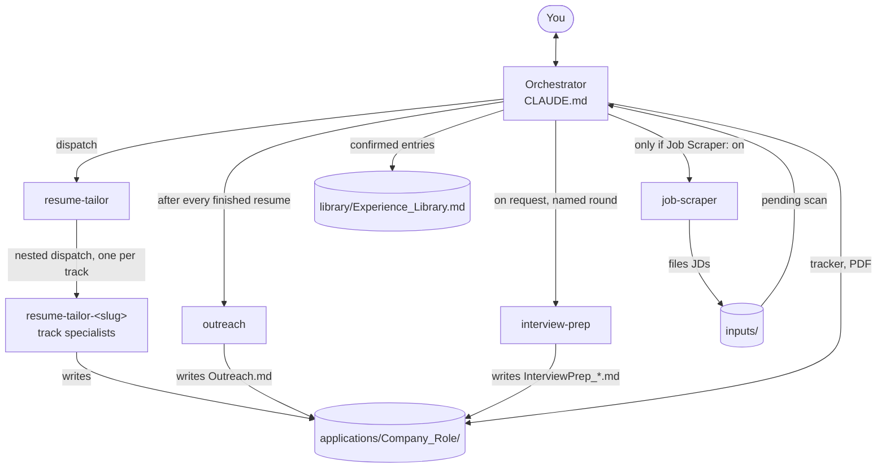

# Architecture

career-crew is a small team of Claude Code agents. The main session (the
orchestrator, configured by `CLAUDE.md`) talks to you; every other agent is a subagent
it dispatches. Agents read your names, tracks, and preferences from `profile/` at
runtime, so the shipped prompts stay generic and only the track specialists are
generated per user.

## Roster

| Role | `subagent_type` | Default name | Tools | Writes |
|---|---|---|---|---|
| Orchestrator | (main session, `CLAUDE.md`) | Scout | all, including `AskUserQuestion` | `applications/Tracker.md`, `library/Experience_Library.md`, run log, PDFs |
| Resume tailor | `resume-tailor` | Weaver | Read, Glob, WebSearch, WebFetch, Agent, SendMessage | nothing |
| Track specialist (one per track) | `resume-tailor-<slug>` | from a pool (Drafter, Marshal, Warden, Kaizen, Volt, then Atlas, Beacon, ...) | Read, Write, Edit, Glob, Bash, WebSearch, WebFetch | tailored `.md`, `.json`, `.docx`, report in the application folder |
| Outreach | `outreach` | Herald | Read, Write, Edit, Glob, WebSearch, WebFetch, read-only Chrome tools | `Outreach.md` |
| Interview prep | `interview-prep` | Sage | Read, Write, Edit, Glob, WebSearch, WebFetch | `InterviewPrep_<Suffix>.md` |
| Job scraper (optional) | `job-scraper` | Fred | Read, Write, Edit, Glob, Apify and JobDataLake tools | `inputs/<date>/` files, its own state files |

Names live in `profile/crew.json` and are chosen during onboarding. They are identity
only; routing always uses `subagent_type`. Only the specialists get `Bash` (they run
the docx generator and `scripts/app_path.js`). Tool lists are asserted by
`test/security-policy.test.js`.

## Dispatch graph

## Checkpoint relay

Subagents cannot call `AskUserQuestion`; only the main session can. So every question
for you travels up the chain as a report and the answer travels back down:

1. A specialist reaches a checkpoint (Step 2.5 gap, Step 2.75 reframing, Step 4
   arrangement, batch) and stops with a report to `resume-tailor`.
2. `resume-tailor` relays it up to the orchestrator. At Step 4 it first reviews the
   arrangement for craft (a JD-grounded rationale for every piece, an AI-phrasing pass)
   and sends it back down until it is clean.
3. The orchestrator reviews Step 4 for strategy (fit with the direction you discussed,
   balance across applications), then asks you via `AskUserQuestion`.
4. The orchestrator resumes `resume-tailor` with `SendMessage`; `resume-tailor` resumes
   the specialist with a **fresh dispatch** carrying everything already confirmed.

Outreach and interview prep use the same stop-and-report pattern one level up, with the
orchestrator reviewing drafts before you see them. The job scraper has no checkpoints
at all, by design: a posting either passes its filters or it doesn't, and it often runs
unattended.

### Why specialists are resumed by fresh dispatch, not `SendMessage`

`SendMessage` from the orchestrator to its direct child (`resume-tailor`) works
reliably. `SendMessage` from `resume-tailor` to its own child (a specialist, a
grandchild of the main session) does not: in practice replies went missing in both
directions, and the harness appeared to register nested agents as children of the root
session rather than of the agent that dispatched them. A fresh `Agent` dispatch of the
same specialist type, with a summary of everything already confirmed, worked every
time. So every specialist checkpoint resumes by fresh dispatch. Please don't
"simplify" this back to `SendMessage`.

### Interrupted runs

A killed subagent counts as cancelled and cannot be resumed. The orchestrator checks
what is on disk (and any checkpoint report already in the conversation), then
dispatches a fresh agent with that state summarized, so nothing is redone or asked
twice.

## Design history

career-crew generalizes a private, single-user system that grew one decision at a time.
The decisions that shaped it, in rough order:

- **Resume tailoring moved into a subagent.** The orchestrator stopped tailoring inline
  and delegates to `resume-tailor`. Two lessons came from its first runs and shaped
  every later agent: no subagent can ask the user directly, so checkpoints are designed
  as "stop and report"; and a killed subagent can't be resumed, so recovery means a
  fresh dispatch with the known state.
- **The Experience Library became the single source.** Resumes are built from a
  library of real experience entries (fixed or flexible, with alternate "faces" and
  date-boundary notes), never from earlier tailored resumes. Only the orchestrator
  writes it, and only with the user's confirmation, so a subagent can never invent
  history.
- **Outreach became its own agent.** Company hooks, contacts, and drafts live in a
  sibling agent that never sends anything; it was given no click or type browser tools
  so sending is structurally impossible. It first ran only when offered and accepted;
  later it was made to run automatically after every finished resume.
- **The tracker moved to the orchestrator,** with a split between facts only the user
  can report (status, date applied, outreach sent, replies) and facts about agent work
  that are set automatically.
- **Step 4 gained reviews.** The orchestrator began reviewing each arrangement
  strategically before the user saw it. Later the resume-tailor took over the craft
  half (rationale per piece, AI-phrasing pass), leaving the orchestrator the strategic
  half. The written report must keep every piece's rationale, because "why is this
  here?" once went unanswerable.
- **Interview prep became its own agent,** on demand only, because only the user knows
  an interview was scheduled. Its first run produced generic answers, so prep was split
  into five fixed round types, each with its own file, emphasis, and answer format
  (STAR, or PSTARP for hiring-manager and final rounds), plus a Green/Yellow/Red JD-fit
  tag per story.
- **The job scraper and autonomous mode.** A scraper files fresh postings from several
  Canadian sources into dated `inputs/` folders. A scheduled run (experimental: the
  user's OS scheduler starts `claude -p` with a prompt beginning `AUTONOMOUS RUN`, the
  only signal that turns the mode on) can continue into tailoring and outreach, resolving most checkpoints itself and logging every decision
  for review; new facts about the user's history are always held for the user. Its
  dedup gained a small file-based knowledge graph (company aliases, track-tagged
  titles, similarity edges) so reposts under a different name are caught, with
  uncertain matches flagged rather than dropped.
- **Track specialists.** One generic tailor was split into a classifier plus one
  specialist per track, each with its own scoring emphasis and header framing. The
  alternative (one agent with a track parameter, as interview prep does for rounds)
  was considered and rejected in favor of real specialization. Track then became a
  recorded field on filed postings and tracker rows, with folders kept flat.
- **Fresh-dispatch resume** for specialists (see above), after nested `SendMessage`
  stalls in a multi-track batch.
- **Smaller rules from use:** PDF became the submitted format (one Word conversion per
  call, foreground only, because backgrounded Word automation hangs); stale,
  low-coverage rows are archived automatically; application submission became a
  guided browser walkthrough with hard permission boundaries.

career-crew itself made these changes on top: everything personal moved into
gitignored `profile/`, `library/`, `inputs/`, and `applications/` folders; the fixed
tracks became 1 to 6 user-defined tracks with generated specialists; rules such as the
em-dash ban, overqualification framing, and the 70% coverage floor became onboarding
defaults; plugin skills became optional with built-in checklists in
`docs/checklists.md`; and every agent gained the untrusted-content rule and
least-privilege tool lists described in the design spec (`docs/specs/`).
